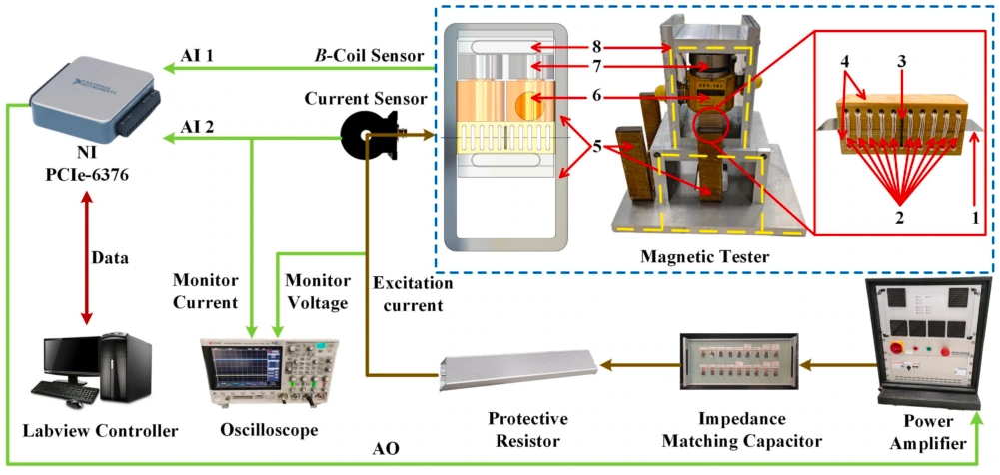

**Authors**　Changgeng Zhang, Guochen Niu, Wenbin Meng, Yongjian Li 
**Journal**　Journal of Magnetism and Magnetic Materials 623, 173013 (2025) 
**First published online**　31 March 2025 
**DOI**　`10.1016/j.jmmm.2025.173013`

<a href="/assets/papers/2025/out-of-plane-stress-in-amorphous-and-nanocrystalline-alloys.pdf" download="out-of-plane-stress-in-amorphous-and-nanocrystalline-alloys.pdf">Download full paper (PDF)</a> · 9 pages · 7.8 MB

## Research brief

The same loading fixture revealed different loss trends in two core materials. Normal stress increased loss in the nanocrystalline samples, while the amorphous samples showed a nonmonotonic response above the kilohertz range.

## Abstract

Nanocrystalline and amorphous alloys are extensively utilized as core materials in devices such as motors and transformers. Their magnetic properties can be altered by stress, significantly impacting the operational efficiency and reliability of electrical equipment. In this study, a wide-frequency-range magnetic property testing system capable of applying out-of-plane stress is designed. The design of the stress application components and the uniformity of stress distribution in the samples are thoroughly analyzed through simulations. This system is used to measure the changes in the magnetic properties of nanocrystalline and amorphous alloy sheets under out-of-plane stress over a wide frequency range. The test results indicate that the out-of-plane stress applied to nanocrystalline alloys leads to an increase in the core loss. The core loss in amorphous alloys initially decreases and subsequently increases at frequencies exceeding the kilohertz range.

<figure style="margin:1.5rem 0">
  
  <figcaption>Figure 1. Loading fixture, magnetic yoke and measurement system for out-of-plane stress tests. <a href="/assets/papers/2025/out-of-plane-stress-in-amorphous-and-nanocrystalline-alloys.pdf#page=2">Figure in the full paper</a></figcaption>
</figure>

[Chinese edition](/zh/news/out-of-plane-stress-in-amorphous-and-nanocrystalline-alloys/) · [News of My Group](/categories)
