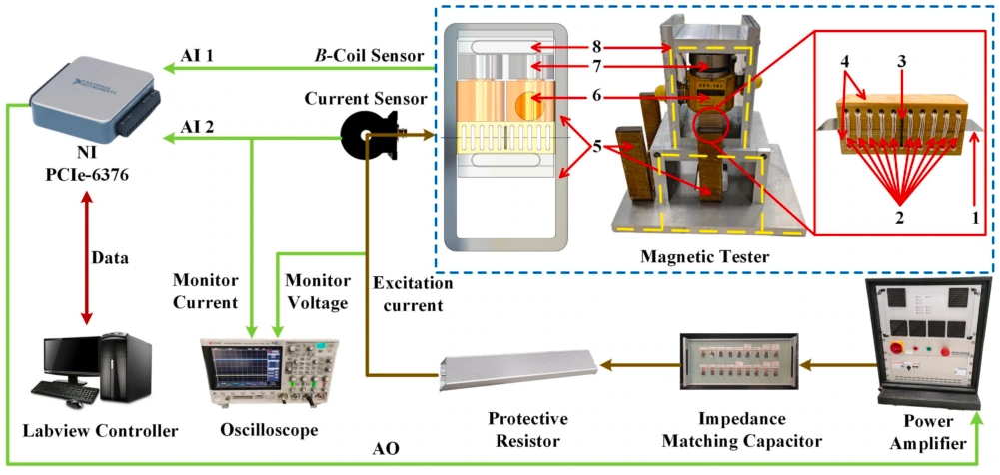

**作者**　张长庚、牛国辰、孟文斌、李永建 
**期刊**　Journal of Magnetism and Magnetic Materials 623, 173013 (2025) 
**首次在线发表**　2025 年 3 月 31 日 
**DOI**　`10.1016/j.jmmm.2025.173013`

<a href="/assets/papers/2025/out-of-plane-stress-in-amorphous-and-nanocrystalline-alloys.pdf" download="out-of-plane-stress-in-amorphous-and-nanocrystalline-alloys.pdf">下载论文全文（PDF）</a> · 9 页 · 7.8 MB

## 研究简介

在同一套施加法向应力的测试装置中，纳米晶试样的铁损上升，而非晶试样在高于千赫兹的频率范围呈现先降后升的趋势。

## 摘要

非晶合金与纳米晶合金广泛用作电机、变压器等设备的铁心材料。应力可改变其磁性能，进而影响电气设备的运行效率和可靠性。研究设计了一套可施加面外应力的宽频磁特性测试系统，并通过仿真分析加载部件设计以及试样内应力分布的均匀性。利用该系统，研究测量了纳米晶和非晶合金片在宽频范围内受法向应力时磁特性的变化。测试表明，纳米晶合金受法向应力后铁损增加。对于非晶合金，在高于千赫兹的频率范围内，铁损随加载先降低、随后升高。

<figure style="margin:1.5rem 0">
  
  <figcaption>图 1　法向应力加载机构、磁轭与磁特性测试装置。 <a href="/assets/papers/2025/out-of-plane-stress-in-amorphous-and-nanocrystalline-alloys.pdf#page=2">图片所在页</a></figcaption>
</figure>

[英文版](/2025/03/04/guochen) · [返回团队新闻](/team-news/)
