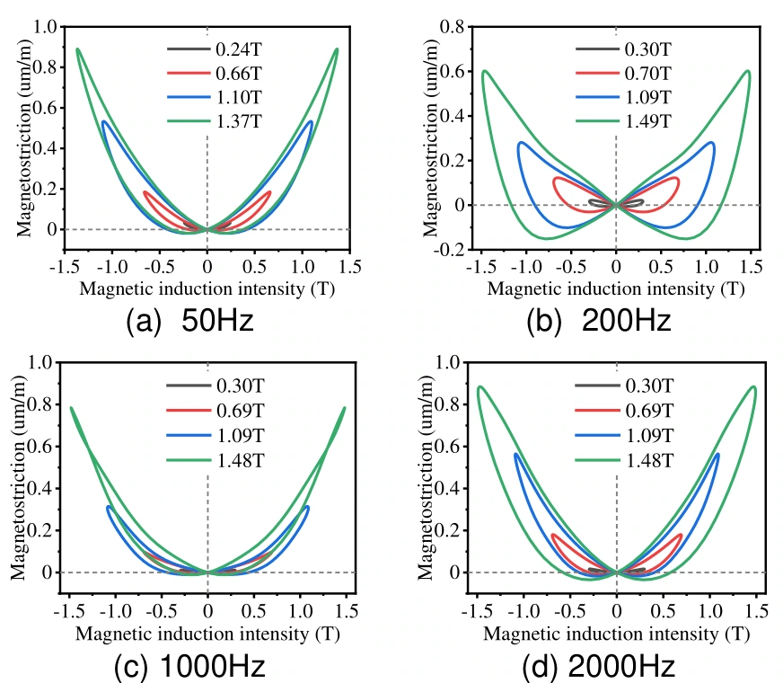

**作者**　陈涛、杨庆新、张长庚、李永建  
**会议**　第十二届国际计算电磁学会议，比利时布鲁日，第七分会场第 17 号论文，2025 年 4 月 10 日

<a href="/assets/papers/2025/measuring-magnetostriction-in-electrical-steel-sheets.pdf" download="measuring-magnetostriction-in-electrical-steel-sheets.pdf">下载会议短文（PDF）</a> · 2 页 · 163 kB

## 研究简介

电工钢片在交变磁化过程中发生微小伸缩，是变压器铁芯振动和噪声的来源之一。团队将单片测试仪与激光干涉仪结合，在同一磁化周期内同步记录磁感应强度和磁致伸缩应变，并据此比较不同频率下的波形。

在所测试的 50 Hz 至 2.5 kHz 范围内，无取向电工钢试样的磁致伸缩大于取向电工钢试样。研究还讨论了磁化谐波和试样自身振动模态对高频测量结果的影响。

## 摘要

磁致伸缩是变压器运行中振动和噪声的重要来源。测量电工钢片在磁化过程中的形变，有助于变压器设计以及振动和噪声控制。研究团队搭建单片磁性能测试仪，配合激光干涉仪测量单张电工钢片试样在交变磁化下的磁致伸缩特性，并研究磁致伸缩随磁化频率的变化规律。

<figure style="margin:1.5rem 0">
  
  <figcaption>图 3 取向电工钢 B30P100 在 50、200、1,000 和 2,000 Hz 下的磁致伸缩应变与磁感应强度关系。 <a href="/assets/papers/2025/measuring-magnetostriction-in-electrical-steel-sheets.pdf#page=2">图片所在页</a></figcaption>
</figure>

[英文版](/2025/04/10/measuring-magnetostriction-in-electrical-steel-sheets) · [返回团队新闻](/team-news/)
