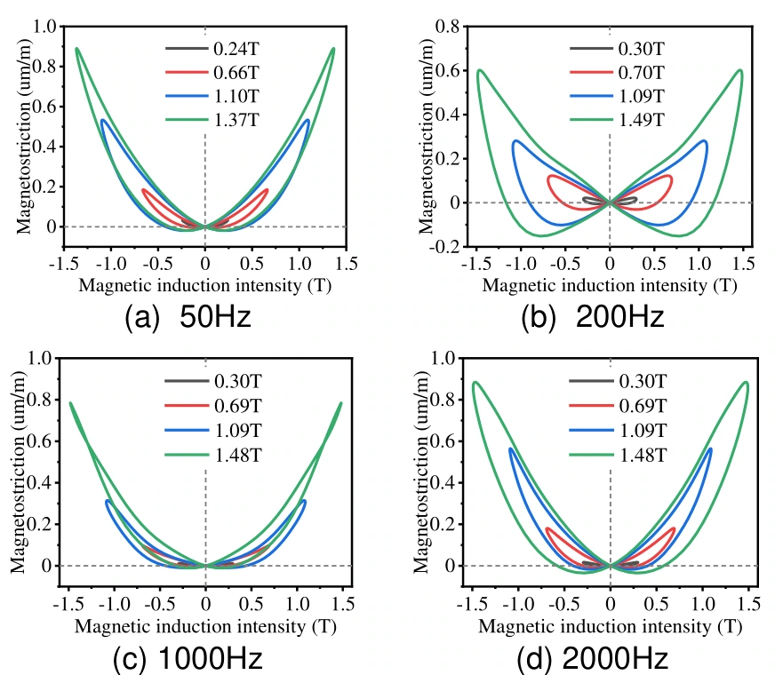

**Authors**　Tao Chen, Qingxin Yang, Changgeng Zhang and Yongjian Li  
**Conference**　12th International Conference on Computation in Electromagnetics, Bruges, Belgium · Session P7, paper 17 · 10 April 2025

<a href="/assets/papers/2025/measuring-magnetostriction-in-electrical-steel-sheets.pdf" download="measuring-magnetostriction-in-electrical-steel-sheets.pdf">Download conference paper (PDF)</a> · 2 pages · 163 kB

## Research summary

Magnetostriction in transformer core sheets contributes to vibration and audible noise. The team combined a single-sheet tester with laser interferometry to record how a sheet changed length over each magnetization cycle. The setup recorded magnetic induction and strain together so their waveforms could be compared as frequency changed.

Across the reported tests from 50 Hz to 2.5 kHz, the non-oriented specimen showed greater magnetostriction than the grain-oriented specimen. The authors also discuss how magnetization harmonics and specimen vibration modes affect the high-frequency response.

## Abstract

Magnetostriction of electrical steel contributes to transformer vibration and noise. Measuring how a sheet deforms during magnetization can therefore inform transformer design and efforts to reduce vibration and noise. The authors combined a single-sheet tester with a laser interferometer to measure the alternating magnetostrictive strain of individual electrical steel specimens. They also investigated how the response changes with magnetizing frequency.

<figure style="margin:1.5rem 0">
  
  <figcaption>Figure 3. Magnetostrictive strain against magnetic induction in grain-oriented B30P100 steel at 50, 200, 1,000 and 2,000 Hz. <a href="/assets/papers/2025/measuring-magnetostriction-in-electrical-steel-sheets.pdf#page=2">Figure in the conference paper</a></figcaption>
</figure>

[Chinese edition](/zh/news/measuring-magnetostriction-in-electrical-steel-sheets/) · [News of My Group](/categories)
