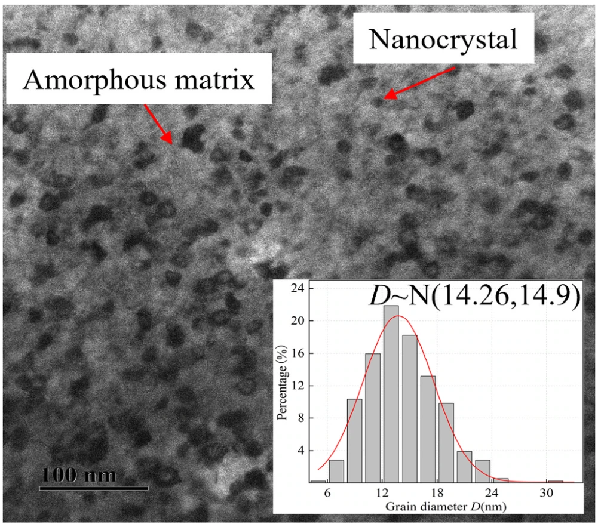

**作者**　孟文斌、张长庚、李永建、张豪 
**期刊**　Journal of Magnetism and Magnetic Materials 629, 173350 (2025) 
**首次在线发表**　2025 年 7 月 11 日 
**DOI**　`10.1016/j.jmmm.2025.173350`

<a href="/assets/papers/2025/grain-size-distribution-in-nanocrystalline-alloy-micromagnetics.pdf" download="grain-size-distribution-in-nanocrystalline-alloy-micromagnetics.pdf">下载论文全文（PDF）</a> · 8 页 · 7.9 MB

## 研究简介

把透射电镜测得的晶粒尺寸分布引入三维微磁模型后，损耗密度和矫顽力预测与实验的平均偏差小于 10%。

## 摘要

电气设备的小型化与轻量化设计推动纳米晶合金在高频电力电子变压器和高频开关电源中得到广泛应用。为阐明纳米晶合金介观磁化行为与宏观磁性能之间的内在联系，研究对 1K107B 纳米晶合金进行了磁特性测量和微磁建模。通过透射电镜观测实际晶粒形貌，构建具有相同晶粒尺寸统计分布的三维微磁仿真模型。结合宽频磁特性测试数据和介观理论，确定微磁仿真的关键参数。与采用均一晶粒尺寸的传统模型相比，改进模型对损耗密度和矫顽力的预测与实测数据之间的平均偏差小于 10%，预测精度更高。这表明，引入实际晶粒尺寸分布有助于更准确地反映纳米晶合金的磁化机制。

<figure style="margin:1.5rem 0">
  
  <figcaption>图 1　用于确定微磁模型晶粒统计特征的纳米晶合金微观组织。 <a href="/assets/papers/2025/grain-size-distribution-in-nanocrystalline-alloy-micromagnetics.pdf#page=2">图片所在页</a></figcaption>
</figure>

[英文版](/2025/07/29/mengwenbin) · [返回团队新闻](/team-news/)
