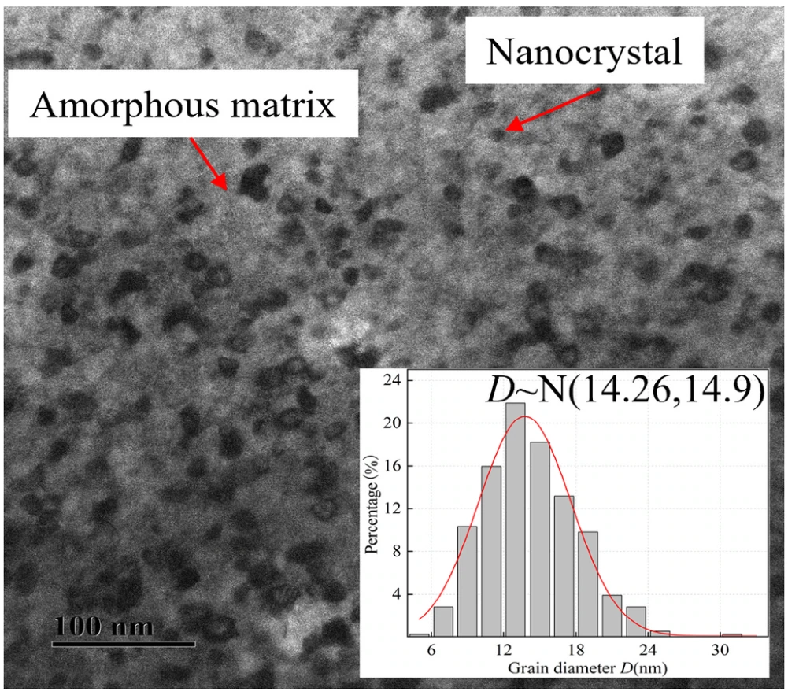

**Authors**　Wenbin Meng, Changgeng Zhang, Yongjian Li, Hao Zhang 
**Journal**　Journal of Magnetism and Magnetic Materials 629, 173350 (2025) 
**First published online**　11 July 2025 
**DOI**　`10.1016/j.jmmm.2025.173350`

<a href="/assets/papers/2025/grain-size-distribution-in-nanocrystalline-alloy-micromagnetics.pdf" download="grain-size-distribution-in-nanocrystalline-alloy-micromagnetics.pdf">Download full paper (PDF)</a> · 8 pages · 7.9 MB

## Research brief

A three-dimensional model built from the measured grain-size distribution reproduced loss density and coercivity with average deviations below 10%.

## Abstract

The miniaturization and lightweight design of electrical equipment result in the widespread application of nanocrystalline alloys in high-frequency power electronic transformers and high-frequency switching power supplies. To elucidate the intrinsic correlation between mesoscopic magnetization behavior and macroscopic magnetic properties of nanocrystalline alloy, magnetic property measurement and micromagnetic modeling are performed on the 1K107B nanocrystalline alloy. The actual grain morphology characteristics are obtained through transmission electron microscopy (TEM) observation, and the three-dimensional micromagnetic simulation model with the same grain size statistical distribution is constructed. The broadband magnetic property test data are combined with mesoscopic theory to determine the key parameters for micromagnetic simulations. Comparative analysis between traditional model with the same grain size and the improved model constructed in this paper, it is found that in the prediction of loss density and coercivity, the average deviation between the improved model and the experimental data is less than 10%, showing higher prediction accuracy than the traditional model. These results indicate that micromagnetic model considering actual grain size distributions can more accurately reflect the magnetization mechanisms in nanocrystalline alloy.

<figure style="margin:1.5rem 0">
  
  <figcaption>Figure 1. Nanocrystalline alloy microstructure used to characterize the grain population for the model. <a href="/assets/papers/2025/grain-size-distribution-in-nanocrystalline-alloy-micromagnetics.pdf#page=2">Figure in the full paper</a></figcaption>
</figure>

[Chinese edition](/zh/news/grain-size-distribution-in-nanocrystalline-alloy-micromagnetics/) · [News of My Group](/categories)
