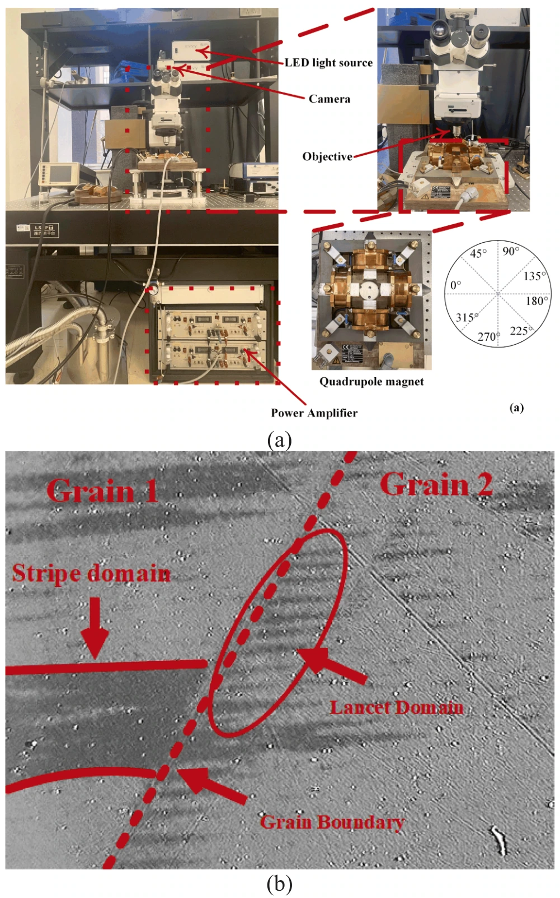

**作者**　张长庚、孙国韬、林志伟 
**期刊**　Journal of Magnetism and Magnetic Materials 630, 173415 (2025) 
**首次在线发表**　2025 年 8 月 5 日 
**DOI**　`10.1016/j.jmmm.2025.173415`

<a href="/assets/papers/2025/rotational-magnetization-and-domain-shapes-in-grain-oriented-steel.pdf" download="rotational-magnetization-and-domain-shapes-in-grain-oriented-steel.pdf">下载论文全文（PDF）</a> · 8 页 · 18.0 MB

## 研究简介

在旋转磁场中连续观察取向电工钢磁畴，团队发现第七个 Hu 不变矩对旋转磁化尤为敏感。

## 摘要

取向电工钢因具有优良的交变磁性能而广泛用于电力变压器。然而，铁心 T 形接合区以旋转磁化为主，其机理仍有待深入认识，也难以准确预测。从磁畴形貌出发研究旋转磁化为这一问题提供了新的途径。研究观测取向电工钢在旋转磁场下磁畴的动态演化，从图像中提取并分析 Hu 矩等形态参数，再以 Hu 矩为输入训练全连接神经网络来预测磁化状态。结果表明，磁畴形态特征可用于神经网络训练与预测，且具有较高准确度。置换特征重要性分析和消融研究进一步确定，第七个 Hu 不变矩是对旋转磁化最敏感的主要特征。

<figure style="margin:1.5rem 0">
  
  <figcaption>图 2　磁光克尔显微镜与所选观测区域的磁畴图像。 <a href="/assets/papers/2025/rotational-magnetization-and-domain-shapes-in-grain-oriented-steel.pdf#page=3">图片所在页</a></figcaption>
</figure>

[英文版](/2025/08/05/rotational-magnetization-and-domain-shapes-in-grain-oriented-steel) · [返回团队新闻](/team-news/)
