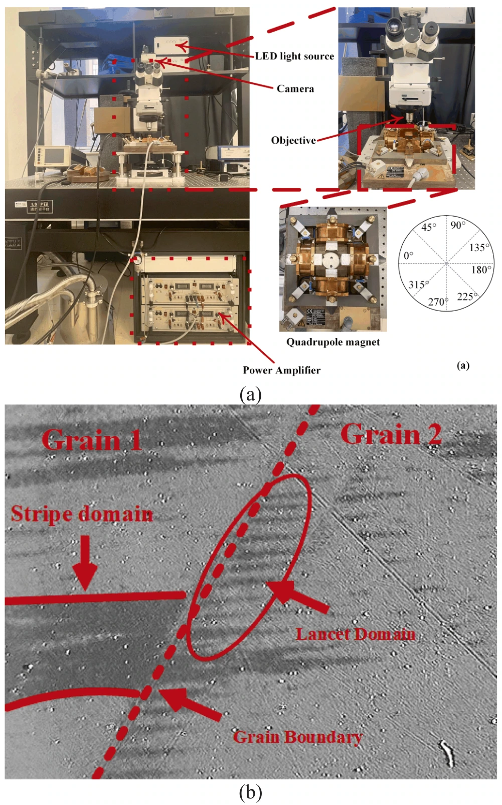

**Authors**　Changgeng Zhang, Guotao Sun, Zhiwei Lin 
**Journal**　Journal of Magnetism and Magnetic Materials 630, 173415 (2025) 
**First published online**　5 August 2025 
**DOI**　`10.1016/j.jmmm.2025.173415`

<a href="/assets/papers/2025/rotational-magnetization-and-domain-shapes-in-grain-oriented-steel.pdf" download="rotational-magnetization-and-domain-shapes-in-grain-oriented-steel.pdf">Download full paper (PDF)</a> · 8 pages · 18.0 MB

## Research brief

Tracking domain shapes as the field rotated identified the seventh Hu moment as a particularly sensitive indicator of magnetization.

## Abstract

Grain-oriented electrical steels (GOES) are widely used in power transformers due to their superior alternating magnetic properties. However, the mechanisms of rotational magnetization dominated in the T-section of transformer cores remain insufficiently explored and poorly predicted. Investigating the rotational magnetization of GOES from the perspective of magnetic domain morphology offers a novel and promising approach to address this research gap. In the study, the dynamic evolution of magnetic domains of grain-oriented electrical steel (GOES) under a rotational magnetic field are observed. Based on the shapes of these domains, the morphological parameters are extracted and analyzed from these domains, such as Hu moments. Subsequently, a full-connected neural network for predicting magnetization is trained using Hu moments as input features. The research results indicate that using morphological features as input data for neural network training and prediction is feasible and achieves high accuracy. In addition, through permutation feature importance (PFI) and ablation study, the parameter of Hu7 is identified as the main feature sensitive to rotational magnetization.

<figure style="margin:1.5rem 0">
  
  <figcaption>Figure 2. Magneto-optical Kerr microscope and domain image of the selected observation region. <a href="/assets/papers/2025/rotational-magnetization-and-domain-shapes-in-grain-oriented-steel.pdf#page=3">Figure in the full paper</a></figcaption>
</figure>

[Chinese edition](/zh/news/rotational-magnetization-and-domain-shapes-in-grain-oriented-steel/) · [News of My Group](/categories)
