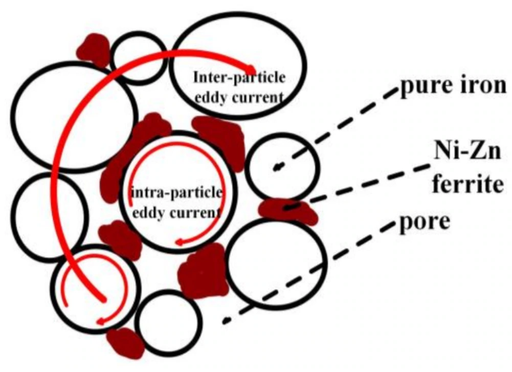

**作者**　张长庚、郭子冉、林志伟、李永建 
**期刊**　Journal of Magnetism and Magnetic Materials 630, 173439 (2025) 
**首次在线发表**　2025 年 8 月 14 日 
**DOI**　`10.1016/j.jmmm.2025.173439`

<a href="/assets/papers/2025/local-demagnetization-in-jiles-atherton-modeling-of-powder-cores.pdf" download="local-demagnetization-in-jiles-atherton-modeling-of-powder-cores.pdf">下载论文全文（PDF）</a> · 9 页 · 8.6 MB

## 研究简介

把颗粒内部退磁场计入有效磁场后，模型更好地描述了粉芯接近饱和的磁化过程，在 10–100 Hz 范围内回线与铁损的相对误差小于 8%。

## 摘要

软磁复合材料具有三维各向同性，可在爪极电机和电力电子装置等三维磁路设备中替代传统叠片软磁材料。为了利用并优化铁基软磁复合材料的特性，需要准确描述其低频和接近饱和磁通密度时的磁性能。研究提出改进的 Jiles–Atherton 磁滞模型，考虑内部退磁对畴壁运动的影响，用有效退磁因子修正有效磁场。同时建立动态磁滞模型，计及颗粒间和颗粒内的涡流损耗。通过放电等离子烧结制得镍锌铁氧体含量为 5 wt% 和 7.5 wt% 的两种铁基样品，并在接近服役条件的静态及动态磁化下测试。实验与仿真比较表明，改进模型能较准确地预测磁滞回线与铁损，在 10–100 Hz 下相对误差小于 8%，接近饱和的回线区域改善尤为明显。

<figure style="margin:1.5rem 0">
  
  <figcaption>图 3　软磁复合材料颗粒内部与颗粒之间的涡流路径示意。 <a href="/assets/papers/2025/local-demagnetization-in-jiles-atherton-modeling-of-powder-cores.pdf#page=4">图片所在页</a></figcaption>
</figure>

[英文版](/2025/08/14/local-demagnetization-in-jiles-atherton-modeling-of-powder-cores) · [返回团队新闻](/team-news/)
