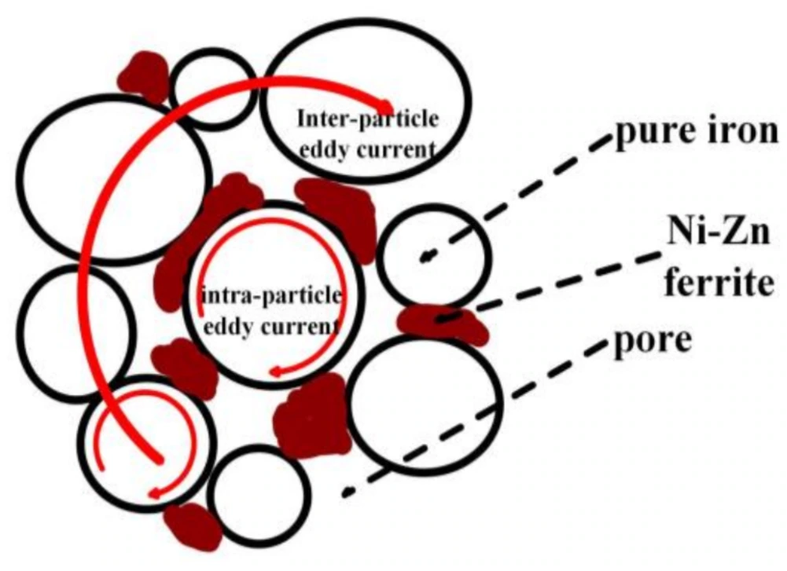

**Authors**　Changgeng Zhang, Ziran Guo, Zhiwei Lin, Yongjian Li 
**Journal**　Journal of Magnetism and Magnetic Materials 630, 173439 (2025) 
**First published online**　14 August 2025 
**DOI**　`10.1016/j.jmmm.2025.173439`

<a href="/assets/papers/2025/local-demagnetization-in-jiles-atherton-modeling-of-powder-cores.pdf" download="local-demagnetization-in-jiles-atherton-modeling-of-powder-cores.pdf">Download full paper (PDF)</a> · 9 pages · 8.6 MB

## Research brief

Accounting for the demagnetizing field within powder cores improved the near-saturation prediction. Relative errors in the loop and loss comparisons were below 8% over 10–100 Hz.

## Abstract

Soft magnetic composites (SMCs), as three-dimensional (3D) isotropic materials can serve as substitutes for traditional laminated soft magnetic materials especially in 3D magnetic circuit devices such as claw-pole motors and power electronics. To utilize and optimize the properties of iron-based SMCs, it is essential to accurately model their magnetic properties at low frequencies and near saturation magnetic flux density. This paper proposes an improved J-A (Jiles-Atherton) model that predicts magnetization in SMCs by considering the influence of internal demagnetization on domain wall motion, incorporating an effective demagnetization factor to adjust the effective field. Simultaneously, a dynamic hysteresis model applicable to SMCs is established for the interparticle and intra-particle eddy current losses of SMCs. Two iron-based SMC samples with 5 wt% and 7.5 wt% Ni-Zn ferrite content were fabricated via spark plasma sintering (SPS) and tested under static and dynamic magnetization of in-service conditions. A comparative analysis of experiments and simulations shows that the improved model accurately predicts hysteresis loops and iron losses, with relative errors under 8% in the 10–100 Hz frequency range, which improvements are especially noticeable at the near saturable area of the simulation loop.

<figure style="margin:1.5rem 0">
  
  <figcaption>Figure 3. Eddy-current paths within and between particles in the soft magnetic composite. <a href="/assets/papers/2025/local-demagnetization-in-jiles-atherton-modeling-of-powder-cores.pdf#page=4">Figure in the full paper</a></figcaption>
</figure>

[Chinese edition](/zh/news/local-demagnetization-in-jiles-atherton-modeling-of-powder-cores/) · [News of My Group](/categories)
