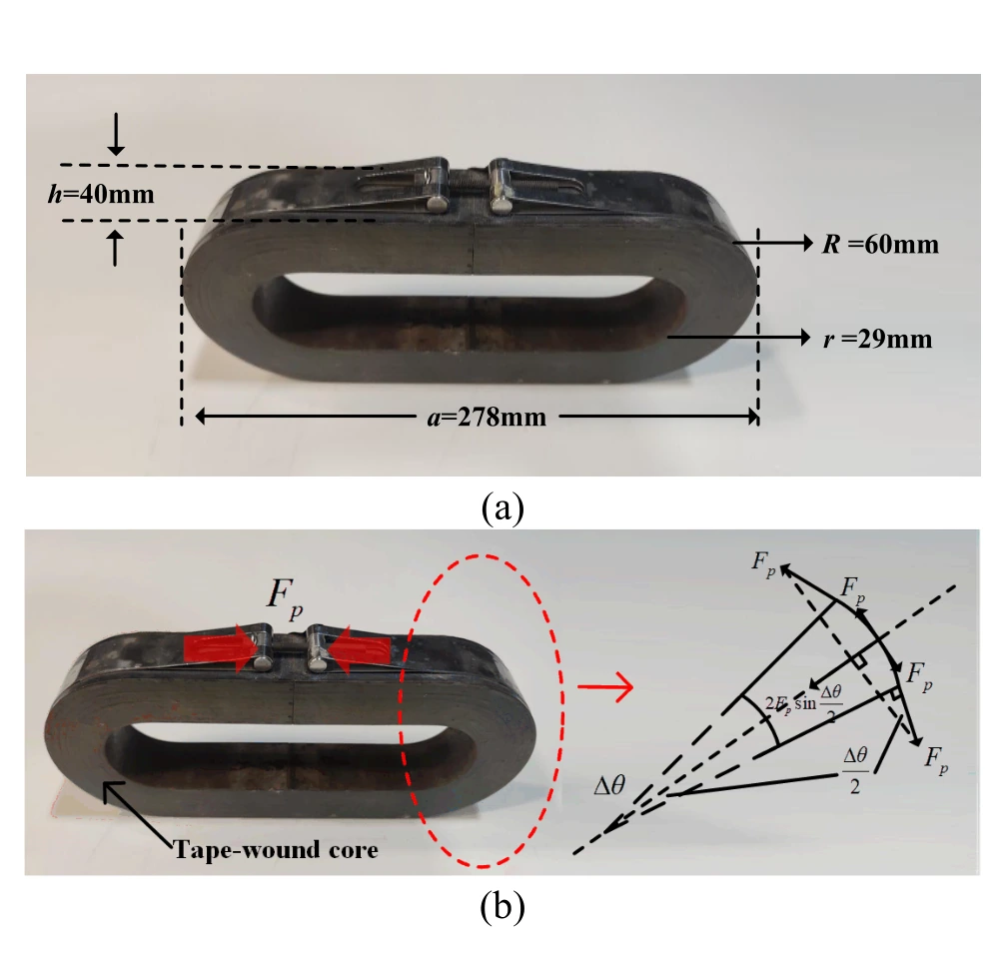

**作者**　陈涛、杨庆新、张长庚、李永建、Yu Dou、岳帅超 
**期刊**　IEEE Transactions on Instrumentation and Measurement 74, 6010312 (2025) 
**首次在线发表**　2025 年 8 月 25 日 
**DOI**　`10.1109/TIM.2025.3602530`

<a href="/assets/papers/2025/electromagnetic-vibration-of-anode-saturable-reactor-cores.pdf" download="electromagnetic-vibration-of-anode-saturable-reactor-cores.pdf">下载论文全文（PDF）</a> · 12 页 · 5.6 MB

## 研究简介

阳极饱和电抗器铁心的钢片具有方向性。团队把这一特性纳入磁－力耦合计算，用实测模态与振动速度检验模型，实验与仿真的误差小于 10%。

## 摘要

阳极饱和电抗器是特高压直流输电换流阀中保护晶闸管的关键设备。本文通过仿真和实验测量研究其磁特性与振动特性。基于材料各向异性，利用有限元方法建立电抗器铁心的振动数值模型，开展磁－力耦合计算并分析结果。为验证模型精度，搭建实验平台测量铁心的振动模态和振动速度。实验与仿真结果对比的误差小于 10%。论文还分析了测量不确定度，并提出提高测量结果稳定性的措施。

<figure style="margin:1.5rem 0">
  
  <figcaption>图 1　阳极饱和电抗器铁心结构、几何尺寸与螺栓预紧力的作用位置。 <a href="/assets/papers/2025/electromagnetic-vibration-of-anode-saturable-reactor-cores.pdf#page=2">图片所在页</a></figcaption>
</figure>

[英文版](/2025/08/25/electromagnetic-vibration-of-anode-saturable-reactor-cores) · [返回团队新闻](/team-news/)
