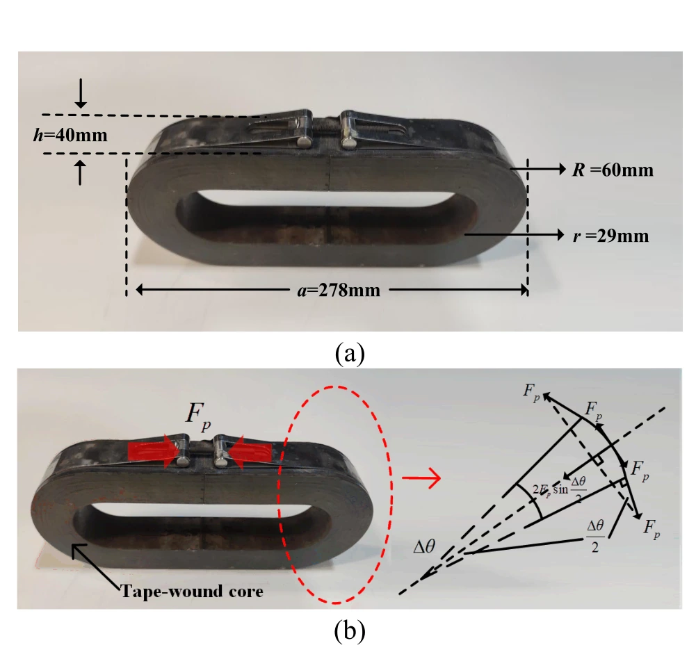

**Authors**　Tao Chen, Qingxin Yang, Changgeng Zhang, Yongjian Li, Yu Dou, Shuaichao Yue 
**Journal**　IEEE Transactions on Instrumentation and Measurement 74, 6010312 (2025) 
**First published online**　25 August 2025 
**DOI**　`10.1109/TIM.2025.3602530`

<a href="/assets/papers/2025/electromagnetic-vibration-of-anode-saturable-reactor-cores.pdf" download="electromagnetic-vibration-of-anode-saturable-reactor-cores.pdf">Download full paper (PDF)</a> · 12 pages · 5.6 MB

## Research brief

A coupled magnetic and mechanical model retained the directional properties of the core steel. Measured vibration modes and velocities tested its predictions, with an experimental-to-simulation discrepancy below 10%.

## Abstract

The anode saturable reactor (ASR) as a pivotal electrical device is used to protect thyristors working in the converter valve of ultrahigh-voltage direct current (UHVdc) power transmission systems. This article aims to delve into the magnetic and vibration characteristics of the ASR by simulation and experimental measurements. Based on the anisotropic material properties, the vibration numerical model of the ASR core is established by the finite element method. The magnetic–mechanical coupling simulation of the core is calculated and analyzed. To verify the accuracy of the model, the vibration modes and the vibration velocity of the core are measured experimentally by building a measuring platform. The error is less than 10% by comparing the experimental results with the simulation results. The uncertainty of the measurement is analyzed and measures to improve the stability of the measurement results are proposed.

<figure style="margin:1.5rem 0">
  
  <figcaption>Figure 1. Core geometry and application of bolt preload in the anode saturable reactor. <a href="/assets/papers/2025/electromagnetic-vibration-of-anode-saturable-reactor-cores.pdf#page=2">Figure in the full paper</a></figcaption>
</figure>

[Chinese edition](/zh/news/electromagnetic-vibration-of-anode-saturable-reactor-cores/) · [News of My Group](/categories)
