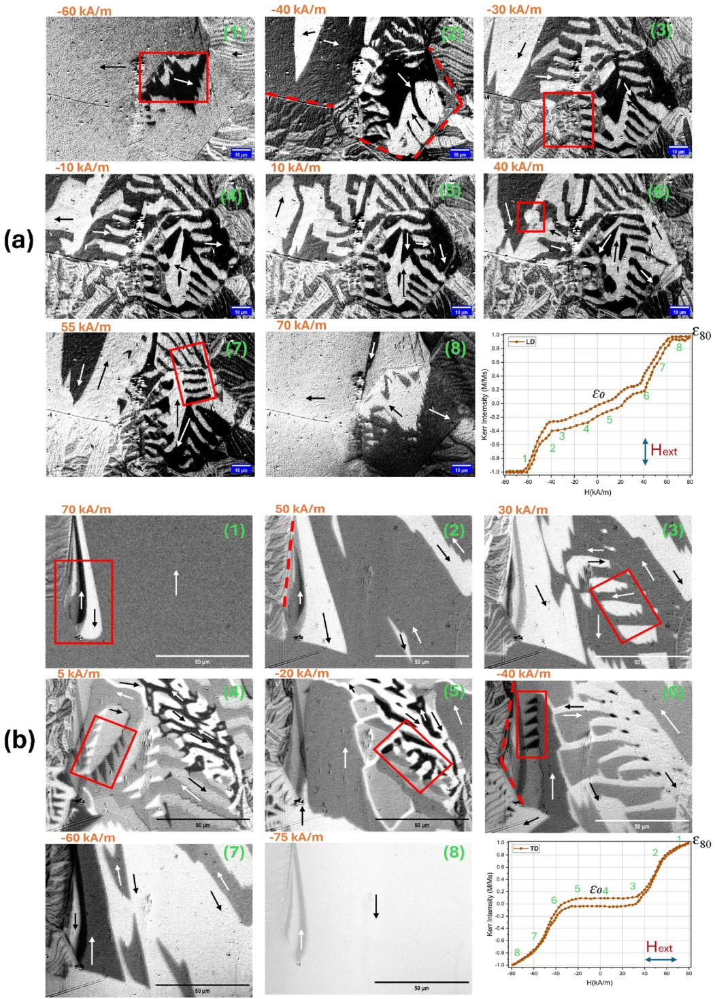

**Authors**　Rawal Shahbaz, Changgeng Zhang, Hina Fatima, Hao Zhang, Yan Zhang  
**Journal**　AIP Advances 16(2), 025124 (2026)  
**First published online**　11 February 2026  
**DOI**　`10.1063/9.0000978`

<a href="/assets/papers/2026/magnetization-direction-at-a-laser-cut-edge.pdf" download="magnetization-direction-at-a-laser-cut-edge.pdf">Download full paper (PDF)</a> · 7 pages · 11.5 MB

## Research brief

In laser-cut electrical steel, the increase in local hysteresis loss near the edge depends on the direction of magnetization.

We imaged magnetic domains in 35WW250 non-oriented electrical steel using the magneto-optical Kerr effect and compared local hysteresis loops at five in-plane magnetization angles. In the longitudinal measurement, hysteresis loss estimated from the loop area was about 10% higher near the edge. In the transverse measurement, it was about 1.5 times the center value.

## Abstract

Laser cutting is an accurate and popular manufacturing process as it is largely employed in most industries in cutting and shaping materials, including electrical steel parts. Nevertheless, laser cutting in the production of motor cores attracts concern regarding its effects to the materials. The resulting localized thermal effects in the cutting can cause mechanical stresses which can also influence the magnetic properties of the electrical steel. In this study, magnetic domains, and their evolution on the magnetic properties of magnets on the surface of non-oriented silicon steel are explored. The magnetization has been carried out at different angles (0°, 30°, 45°, 60°, 90°) to examine local hysteresis properties by magneto-optic Kerr effect methods. Findings indicate that laser cutting causes variations in domain orientations along the cutting edge, more core losses and reduced magnetic susceptibility. Hysteresis loss was observed at the cutting edge 10% higher in the longitudinal direction than loss in the center sample. The loss experienced around the cutting edge in the transverse directions is also 1.5 times the loss experienced at the center, in which case, this means that the energy loss is significantly large. These results indicate that the cutting edge can undergo various changes in microstructural or stress microstructure, as compared to the sheet of the center.

<figure style="margin:1.5rem 0">
  
  <figcaption>Figure 5. Domain patterns near the cut edge in longitudinal and transverse Kerr measurements at the points marked in green on the hysteresis curve. <a href="/assets/papers/2026/magnetization-direction-at-a-laser-cut-edge.pdf#page=5">Figure in the full paper</a></figcaption>
</figure>

[Chinese edition](/zh/news/magnetization-direction-at-a-laser-cut-edge/)
