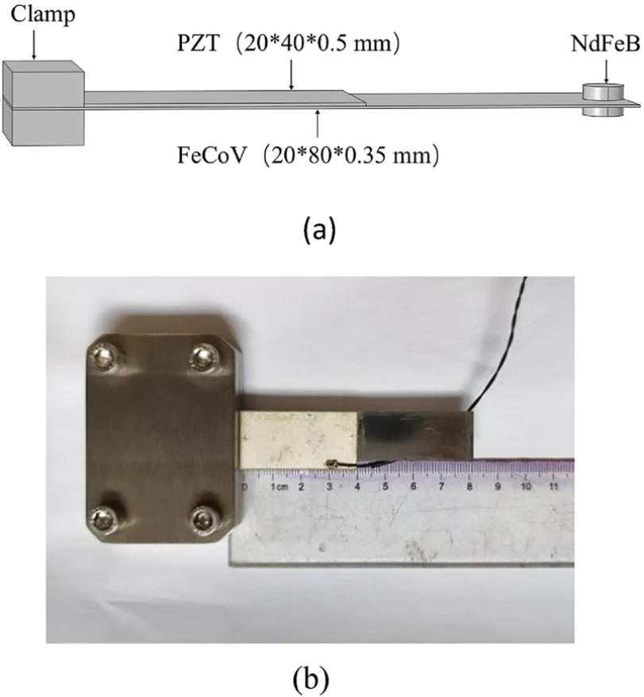

**作者**　Changgeng Zhang, Ziyang Wang, Haiming Jiao, Mingming Li, Yongjian Li, Zhiwei Lin  
**期刊**　AIP Advances 16(2), 025132 (2026)  
**首次在线发表**　2026 年 2 月 17 日  
**DOI**　`10.1063/9.0000992`

<a href="/assets/papers/2026/magnetoelectric-energy-harvesting-at-power-frequency.pdf" download="magnetoelectric-energy-harvesting-at-power-frequency.pdf">下载论文全文（PDF）</a> · 6 页 · 5.2 MB

## 研究简介

通过调整梁端永磁体的质量，磁电悬臂梁可在接近 50 Hz 的交流磁场中共振发电。

我们根据 Ericsson 循环的能量转换分析选用 FeCoV 磁致伸缩层，与 PZT 压电陶瓷复合成悬臂梁，并用梁端钕铁硼磁体调节共振频率。样机在 51 Hz 时的磁电电压系数达到 3.8 V/(cm·Oe)。在 10 Oe 交流磁场下，测得的最大输出功率密度为 7.6 μW/cm³。

## 摘要

随着电力物联网传感节点供电需求的增长，如何在工频变压器附近实现稳定的自供电运行成为亟待解决的问题。本文设计了一种基于 FeCoV–PZT 层合磁电复合材料的能量采集器，用于采集电力变压器周围 50 Hz 杂散磁场的能量。研究以埃里克森循环理论为依据选择磁致伸缩相，综合其能量转换潜力后选用 FeCoV。采用自由端装有钕铁硼永磁体的悬臂梁结构，使器件的共振频率显著降低并与工频匹配，在无需外加偏置磁场的情况下提高磁电转换效率。试验表明，经过结构优化，共振频率可降至约 50 Hz，转换效率得到明显改善。测得的峰值磁电系数为 3.8 V/(cm·Oe)，最大输出体积功率密度为 7.6 μW/cm³，表明该器件具有实际应用潜力。

<figure style="margin:1.5rem 0">
  
  <figcaption>图 1　FeCoV–PZT 磁电悬臂梁的结构示意图与样机照片。 <a href="/assets/papers/2026/magnetoelectric-energy-harvesting-at-power-frequency.pdf#page=4">图片所在页</a></figcaption>
</figure>

[英文版](/2026/02/17/magnetoelectric-energy-harvesting-at-power-frequency) · [返回团队新闻](/team-news/)
