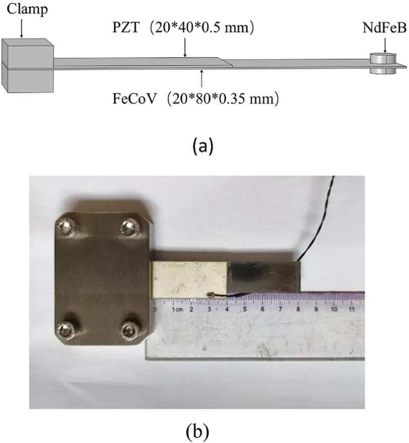

**Authors**　Changgeng Zhang, Ziyang Wang, Haiming Jiao, Mingming Li, Yongjian Li, Zhiwei Lin  
**Journal**　AIP Advances 16(2), 025132 (2026)  
**First published online**　17 February 2026  
**DOI**　`10.1063/9.0000992`

<a href="/assets/papers/2026/magnetoelectric-energy-harvesting-at-power-frequency.pdf" download="magnetoelectric-energy-harvesting-at-power-frequency.pdf">Download full paper (PDF)</a> · 6 pages · 5.2 MB

## Research brief

A tip magnet tunes a magnetoelectric cantilever to the 50 Hz range for harvesting energy from stray transformer fields.

An Ericsson-cycle analysis guided the choice of FeCoV for the magnetostrictive layer. We bonded it to PZT piezoceramic and tuned the cantilever resonance with a neodymium tip magnet. The prototype reached a magnetoelectric voltage coefficient of 3.8 V/(cm·Oe) at 51 Hz. Under a 10 Oe alternating field, its maximum output power density was 7.6 μW/cm³.

## Abstract

With the increasing demand for power supply in power Internet-of-Things (IoT) sensor nodes, providing stable, self-powered operation near power-frequency transformers remains a critical challenge. This paper presents the design of an energy harvester based on FeCoV–PZT laminated magnetoelectric composites for efficiently harvesting 50 Hz stray magnetic field energy around power transformers. This study leverages the Ericsson cycle theory as a guiding principle for the critical selection of the magnetostrictive phase, ultimately identifying FeCoV for its optimal energy conversion potential. By employing a cantilever structure integrated with an NdFeB permanent magnet at the free end, the resonant frequency of the device is significantly reduced and matched to the power frequency, thereby enhancing the magnetoelectric conversion efficiency without requiring a bias magnetic field. Experimental results demonstrate that, through structural optimization, the resonant frequency can be reduced to ≈50 Hz, substantially improving conversion efficiency; a peak magnetoelectric coefficient of 3.8 V/(cm Oe) and a maximum output volume power density of 7.6 μW/cm³ were achieved, showing its potential for practical applications.

<figure style="margin:1.5rem 0">
  
  <figcaption>Figure 1. Schematic and photograph of the FeCoV–PZT magnetoelectric cantilever. <a href="/assets/papers/2026/magnetoelectric-energy-harvesting-at-power-frequency.pdf#page=4">Figure in the full paper</a></figcaption>
</figure>

[Chinese edition](/zh/news/magnetoelectric-energy-harvesting-at-power-frequency/)
