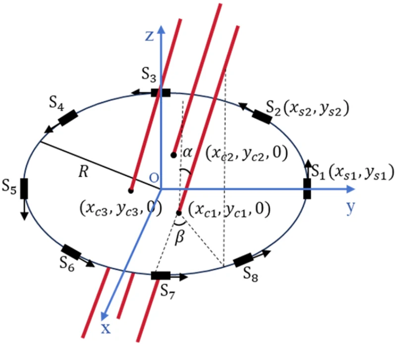

**作者**　Fugui Liu, Shuai Zhao, Shuokao Mu, Yongjian Li, Changgeng Zhang  
**期刊**　AIP Advances 16(2), 025237 (2026)  
**首次在线发表**　2026 年 2 月 18 日  
**DOI**　`10.1063/9.0000987`

<a href="/assets/papers/2026/measuring-cable-currents-with-a-tmr-array.pdf" download="measuring-cable-currents-with-a-tmr-array.pdf">下载论文全文（PDF）</a> · 6 页 · 5.8 MB

## 研究简介

布置在电缆外的一圈磁传感器，可以从叠加磁场中分辨出三根导体各自的电流。

我们用八个隧道磁阻（TMR）传感器测量电缆周围的磁场，通过两阶段优化估计导体位置和倾角，再重建各相电流。在三相平衡试验中，所测布置下的最大相对误差低于 7%。在一组相同导体位置的对照试验中，加入倾角补偿后，基波电流幅值误差由 6.03% 降至 1.2%。

## 摘要

智能电网的电流实时监测面临多项挑战，尤其是多芯电缆中固有的相电流不平衡和复杂的电磁耦合会使磁场分布畸变，增加精确测量的难度。传统非侵入式技术多用于单根导体，对不同多导体布置的适应性不足，安装时还需要中断运行。为此，本研究采用环形隧道磁阻（TMR）传感器阵列，提出带角度补偿的多芯电缆非侵入式电流测量方法。建立同时考虑导体位置和倾角的电流反演模型，并结合粒子群优化与莱文伯格–马夸尔特算法，通过两阶段优化高效求解反演问题。实验结果表明，在三相平衡条件下，最大电流误差低于 7%。在导体偏心的情况下，该方法仍能保持较高精度，可用于多种导体布置下的可靠非侵入式电流测量。

<figure style="margin:1.5rem 0">
  
  <figcaption>图 1　用于三芯电缆电流测量的环形隧道磁阻传感器阵列及其几何布置。 <a href="/assets/papers/2026/measuring-cable-currents-with-a-tmr-array.pdf#page=3">图片所在页</a></figcaption>
</figure>

[英文版](/2026/02/18/measuring-cable-currents-with-a-tmr-array) · [返回团队新闻](/team-news/)
