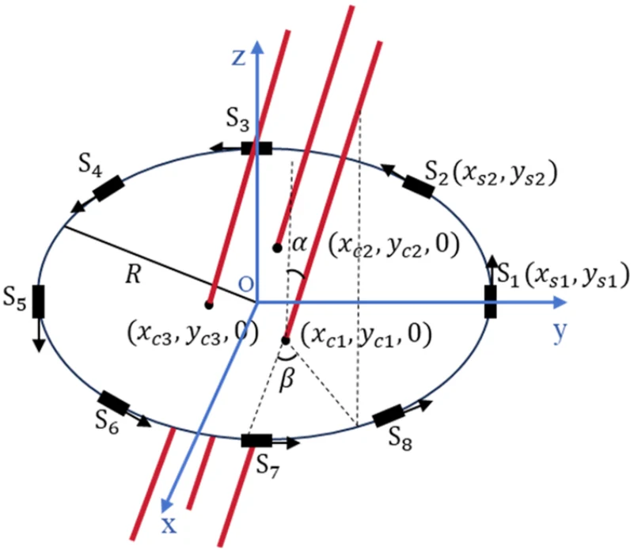

**Authors**　Fugui Liu, Shuai Zhao, Shuokao Mu, Yongjian Li, Changgeng Zhang  
**Journal**　AIP Advances 16(2), 025237 (2026)  
**First published online**　18 February 2026  
**DOI**　`10.1063/9.0000987`

<a href="/assets/papers/2026/measuring-cable-currents-with-a-tmr-array.pdf" download="measuring-cable-currents-with-a-tmr-array.pdf">Download full paper (PDF)</a> · 6 pages · 5.8 MB

## Research brief

A ring of magnetic sensors separates the contributions of three conductors to the field measured outside a cable.

Eight tunneling magnetoresistance (TMR) sensors sampled the field around a three-conductor cable. A two-stage optimization estimated conductor positions and tilt angles before reconstructing the phase currents. The maximum relative error stayed below 7% across the balanced three-phase tests. For one fixed conductor arrangement, tilt compensation reduced the fundamental current amplitude error from 6.03% to 1.2%.

## Abstract

Real-time current monitoring of currents in smart grid poses significant challenges, particularly within multi-conductor cables where inherent phase imbalance and complex electromagnetic coupling distort the magnetic field patterns, complicating accurate measurement. Conventional non-invasive techniques are often applied to a single conductor, insufficient adaptability to multiple varying conductor arrangements, and require operational interruption for installation. To address these issues, this study designs an angle-compensated non-invasive current measurement method for multi-conductor cables with an annular TMR sensor array. A current inversion model incorporating conductor position and inclination parameters is established. A dual-stage optimization strategy combining Particle Swarm Optimization and the Levenberg–Marquardt Algorithm is proposed to solve the inversion problem efficiently. Experimental results demonstrate that the maximum current error remains below 7% under balanced three-phase conditions. The method also maintains high accuracy in the presence of conductor eccentricity, enabling reliable non-invasive current measurement across diverse multi-conductor configurations.

<figure style="margin:1.5rem 0">
  
  <figcaption>Figure 1. Geometry of the annular TMR sensor array used to measure currents in a three-conductor cable. <a href="/assets/papers/2026/measuring-cable-currents-with-a-tmr-array.pdf#page=3">Figure in the full paper</a></figcaption>
</figure>

[Chinese edition](/zh/news/measuring-cable-currents-with-a-tmr-array/)
