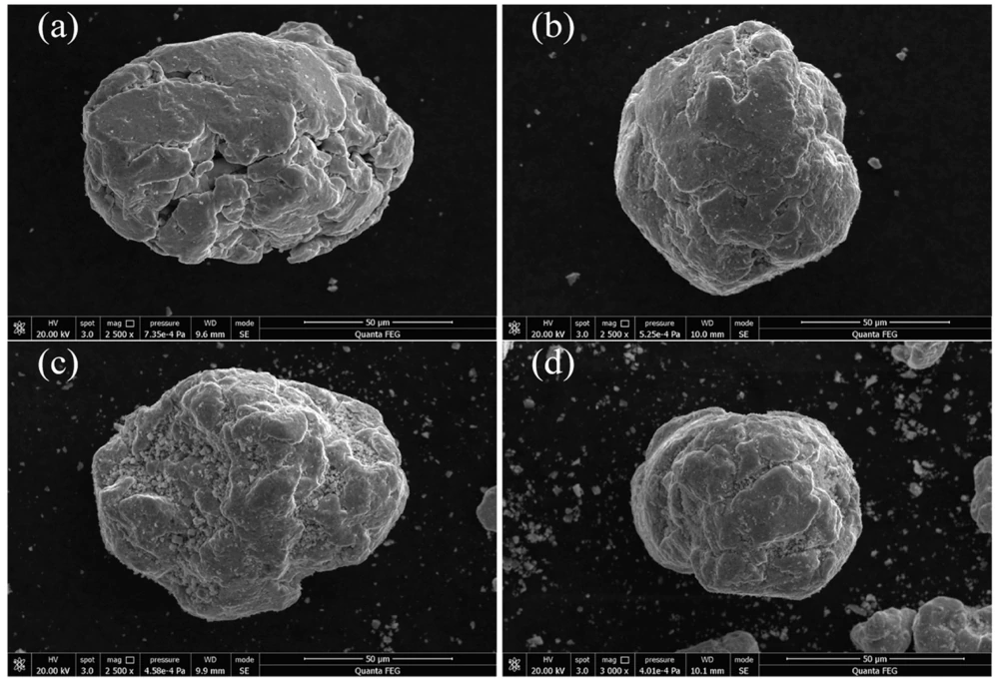
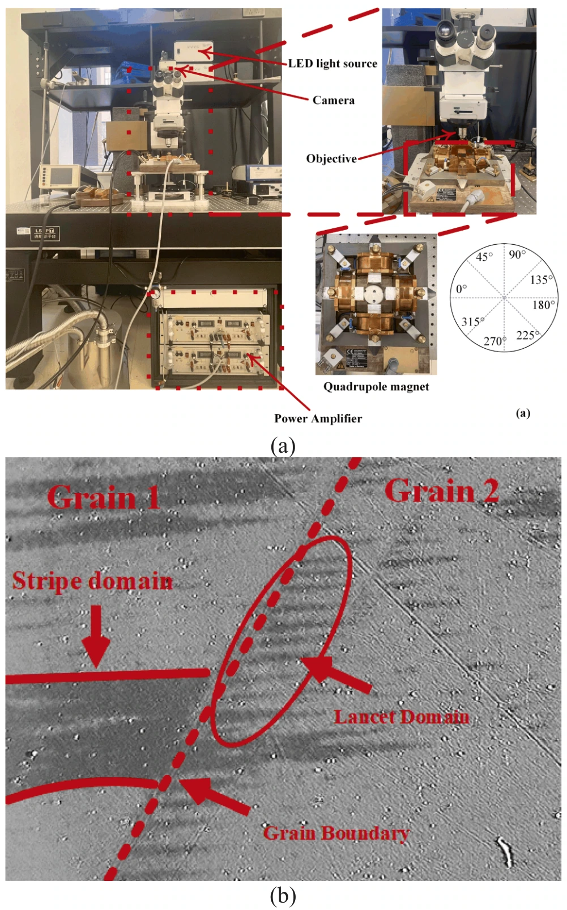

2026 年 5 月 21 日，张长庚教授指导的郭子冉、孙国韬、王锴和刘潇潇在河北工业大学电气工程学院通过硕士学位论文答辩。四位同学的研究从微观到宏观，既涉及单个磁粉颗粒表面的包覆层，也涉及整台变压器的振动。



## 从粉末表面和钢片磁畴看磁性能

**郭子冉**研究用镍锌铁氧体包覆铁粉，再经低压放电等离子烧结制成磁粉芯。他用扫描电镜观察颗粒表面的包覆情况，再对照不同配比样品的电导率、磁导率与损耗。在团队发表的研究中，四种配比的比较显示，铁氧体质量分数为 **2.5%** 的样品在 **20–200 kHz** 范围内取得了最好的综合磁性能。他在学位论文中进一步将颗粒的退磁效应纳入磁滞模型，用于计算磁粉芯的磁化特性。

<figure style="max-width:38rem;margin:1.25rem auto">
  
  <figcaption>不同镍锌铁氧体含量下的复合粉末表面。图片出自郭子冉参与发表的论文图 3。<a href="/zh/news/low-pressure-sintering-of-iron-ferrite-powder-cores/">论文与图像来源</a></figcaption>
</figure>

**孙国韬**研究取向电工钢的磁畴怎样随外磁场转动而变化。他利用磁光克尔显微镜连续观测同一片区域，提取磁畴形状的特征，再与钢片整体的磁化状态对照。这样，一组显微图像既记录了畴壁怎样移动，也能用于预测材料在旋转磁场中的磁化响应。

<figure style="max-width:25rem;margin:1.25rem auto">
  
  <figcaption>磁光克尔显微镜与同一观测区域内的磁畴。图片出自孙国韬参与发表的论文图 2。<a href="/zh/news/rotational-magnetization-and-domain-shapes-in-grain-oriented-steel/">论文与图像来源</a></figcaption>
</figure>

## 从振动信号识别设备状态

**王锴**在干式变压器试验平台上采集振动信号，研究能否从这些信号中判断铁心上轭哪一相的紧固螺栓出现松动。针对故障样本有限的问题，他比较了不同测点的信号，并分别检验了识别铁心松动和绕组故障的方法。

**刘潇潇**围绕电接触与结构振动开展了研究。
