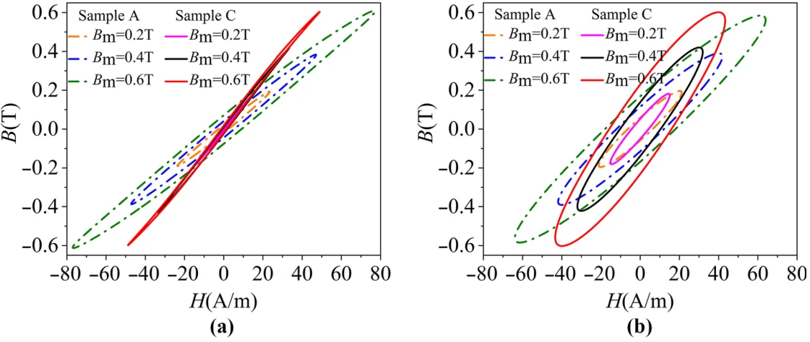

**Authors**　Wenbin Meng, Changgeng Zhang, Yongjian Li, He Sun, Qingxin Yang, Pia Lindh  
**Journal**　COMPEL (2026)  
**First published online**　29 May 2026  
**DOI**　`10.1108/COMPEL-01-2026-0043`

<a href="/assets/papers/2026/dimensions-and-magnetic-properties-of-nanocrystalline-laminates.pdf" download="dimensions-and-magnetic-properties-of-nanocrystalline-laminates.pdf">Download full paper (PDF)</a> · 14 pages · 5.3 MB

## Research brief

Laminates made from the same batch of nanocrystalline ribbon can show different losses at the same frequency and peak flux density.

We tested seven geometries of 1K107B nanocrystalline laminates under sinusoidal excitation at 1–15 kHz and 0.1–0.6 T. Width had the strongest effect in this set of specimens, followed by length and thickness. Wider specimens showed higher loss density and coercivity and lower permeability, particularly at higher frequencies. An analytical model showed the field strength decreasing from the edges toward the center of a finite-width laminate.

## Abstract

**Purpose** – This paper aims to investigate the influence of geometric dimensions on the macroscopic magnetic properties of nanocrystalline laminates through experimental measurement and analytical interpretation.

**Design/methodology/approach** – This paper develops a new system for testing the magnetic properties of nanocrystalline laminates with different dimensions and examines seven laminates of two types under various flux densities and excitation frequencies. The effects of geometric parameters, such as length-width ratio and thickness-width ratio, on typical magnetic parameters, including loss density, permeability and coercivity, are investigated through comparative analysis of the experimental data. Furthermore, the established analytical model is used to investigate the nonuniform internal magnetic field intensity distribution in nanocrystalline laminates with different dimensions.

**Findings** – The results demonstrate that wider laminates exhibit higher loss density, reduced permeability and increased coercivity, with the dimensional influence becoming more pronounced at higher frequencies. Furthermore, the analytical results provide a qualitative explanation for the nonuniform internal magnetic field intensity distribution caused by dimensional variations. Overall, within the investigated dimensional range and excitation conditions of this work, the influence of geometric parameters on the magnetic performance of nanocrystalline laminates tends to increase in the order of thickness, length and width and the effect is frequency-dependent.

**Originality/value** – This work not only proposes an effective testing method for nanocrystalline laminates of variable dimensions but also provides theoretical and experimental insights for optimizing the design of high-frequency magnetic components.

**Keywords**　Nanocrystalline alloy, Magnetic properties, Laminated sample

<figure style="margin:1.5rem 0">
  
  <figcaption>Figure 5. Hysteresis loops of nanocrystalline laminates with different length-to-width ratios at 1 kHz and 15 kHz. <a href="/assets/papers/2026/dimensions-and-magnetic-properties-of-nanocrystalline-laminates.pdf#page=7">Figure in the full paper</a></figcaption>
</figure>

[Chinese edition](/zh/news/dimensions-and-magnetic-properties-of-nanocrystalline-laminates/)
