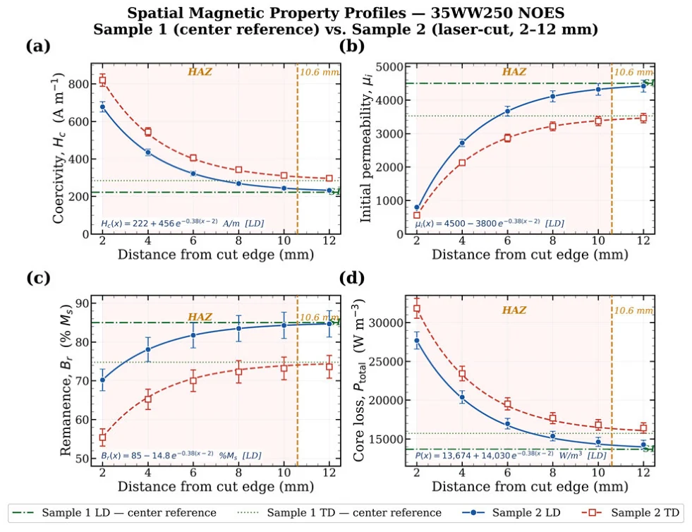

**Authors**　Rawal Shahbaz, Changgeng Zhang, Hina Fatima, Raja Saqib Arshad, Sujun Babu  
**Journal**　IEEE Transactions on Magnetics 62(9), 6000209 (2026)  
**First published online**　8 July 2026  
**DOI**　`10.1109/TMAG.2026.3711353`

<a href="/assets/papers/2026/extent-of-laser-cutting-damage-in-electrical-steel.pdf" download="extent-of-laser-cutting-damage-in-electrical-steel.pdf">Download full paper (PDF)</a> · 9 pages · 2.4 MB

## Research brief

Local hysteresis measurements trace how magnetic properties recover with distance from a laser-cut edge.

We measured local Kerr hysteresis loops at six positions 2–12 mm from the laser-cut edge of 35WW250 non-oriented electrical steel and classified the domain images by shape. Coercivity reached 678 A/m at 2 mm, compared with 222 A/m in a reference specimen from the sheet center. The spatial profiles and domain patterns indicated an affected width of about 10.6 mm for this steel and cutting process.

## Abstract

Nonoriented electrical steel (NOES) is the cornerstone soft magnetic material for transformer cores and motor laminations, yet laser cutting degrades magnetic performance through localized thermal damage that fundamentally alters domain microstructure and wall dynamics. While prior studies qualitatively documented domain distortion near cut edges, quantitative methods linking microscopic domain evolution to macroscopic hysteresis remain limited. This study systematically quantifies laser cutting-induced magnetic domain reconfiguration in grade 35WW250 NOES using a NanoMOKE3 scanning magneto-optical Kerr effect (MOKE) magnetometer across a 2–12 mm spatial gradient in longitudinal and transverse geometries. A principal methodological innovation is the application of the seven invariant Hu moment set and principal component analysis (PCA) to categorize domain morphology into K = 4 distinct clusters, capturing >87% of morphological variance, providing a framework for estimating macroscopic hysteresis loops through weighted averaging of local magneto-optical responses. Results reveal severe spatial degradation: coercivity increased 206% (222–678 A/m) and the reconstructed hysteresis component of core loss nearly doubled (13 674–27 704 W/m³ at 50 Hz, 1.0 T) within 2 mm of the cut edge, driven by domain wall rigidification and staircase-type hysteresis from intensified pinning. The domain wall pinning coefficient rose 3.18-fold (250–795 A/m) while initial permeability collapsed 5.6-fold. A physically significant crossover field H∗ ≈ 989 A/m is identified, below which rigid cut-edge walls dissipate less energy than the undamaged interior. All parameters recovered to within 4%–8% of reference values at 12 mm, defining a ∼10.6 mm practical damage zone.

**Keywords**　Core loss, Hu moment invariants, laser cutting, magnetic degradation, magnetic domain dynamics, magnetization curves, magneto-optical Kerr effect (MOKE), nonoriented electrical steel (NOES)

<figure style="margin:1.5rem 0">
  
  <figcaption>Figure 5. Coercivity, initial permeability, remanence and estimated loss at distances of 2–12 mm from the cut edge. The vertical dashed lines mark the damage boundary identified in the study. <a href="/assets/papers/2026/extent-of-laser-cutting-damage-in-electrical-steel.pdf#page=5">Figure in the full paper</a></figcaption>
</figure>

[Chinese edition](/zh/news/extent-of-laser-cutting-damage-in-electrical-steel/)
