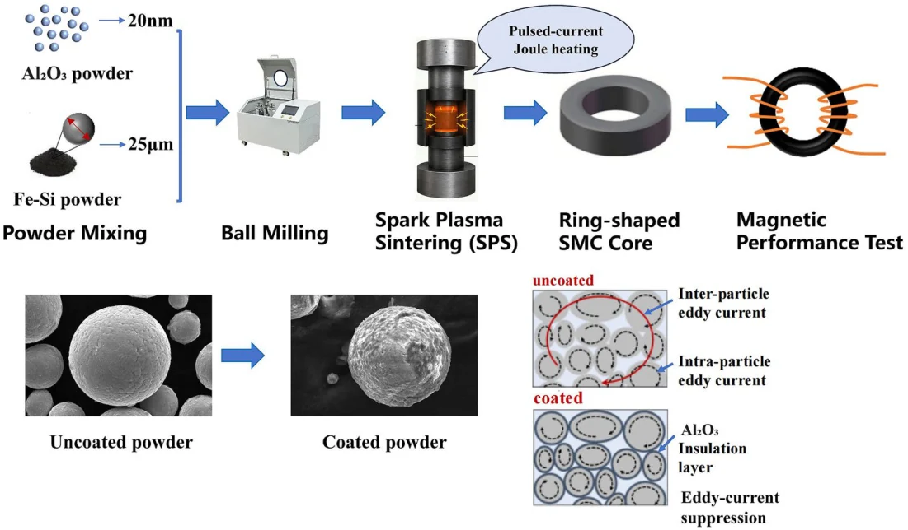

**作者**　Fugui Liu, Yupeng Chen, Changgeng Zhang, Zhiwei Lin, Yongjian Li, Kai Liu  
**期刊**　Journal of Electronic Materials 55, 8866–8879 (2026)  
**首次在线发表**　2026 年 8 月 5 日  
**DOI**　`10.1007/s11664-026-13088-2`

<a href="/assets/papers/2026/alumina-insulation-in-fe-si-powder-cores.pdf" download="alumina-insulation-in-fe-si-powder-cores.pdf">下载论文全文（PDF）</a> · 14 页 · 7.9 MB

## 研究简介

氧化铝能阻断铁硅颗粒间的涡流，但包覆量增加也会削弱颗粒间的磁耦合。

我们用高能球磨和放电等离子烧结制备了不同氧化铝含量的 Fe–6.5 wt.% Si 粉芯。在 500 kHz、20 mT 下，未包覆样品的铁损为 5057.1 W/kg，添加 7.5 wt.% 氧化铝后降至 253.6 W/kg。含量增至 10 wt.% 时铁损继续下降，磁导率也随之降低。在所测配方中，7.5 wt.% 较好地兼顾了低损耗和磁导率的频率稳定性。

## 摘要

铁硅软磁复合材料（SMC）在高频工作时通常会出现磁导率稳定性变差、涡流损耗上升的问题，限制了其在先进电力电子设备中的应用。本研究采用高能球磨和放电等离子烧结（SPS）制备了具有氧化铝绝缘包覆层的 Fe–6.5 wt.% Si 软磁复合材料，系统研究了氧化铝含量对微观组织、电阻率和 500 kHz 以下磁特性的影响。引入氧化铝可改善铁硅颗粒间的电绝缘，提高电阻率，降低高频磁芯损耗。扫描电子显微镜观测和能量色散 X 射线谱线扫描表明，氧化铝含量由 2.5 wt.% 增至 7.5 wt.% 时，铁硅颗粒表面的包覆由不完整覆盖逐渐变为较连续的绝缘层。随着这一结构变化，磁导率的频率稳定性提高，磁损耗显著降低。在所测试样中，氧化铝含量为 7.5 wt.% 的材料在稳定磁导率与降低磁芯损耗之间取得了最佳平衡。磁性能的改善主要得益于包覆层增强了颗粒间绝缘并抑制了涡流效应。上述结果为面向高频应用的铁硅软磁复合材料优化提供了参考。

**关键词**　软磁复合材料、放电等离子烧结、涡流损耗抑制、磁损耗分析

<figure style="margin:1.5rem 0">
  
  <figcaption>图文摘要　铁硅粉芯的球磨、放电等离子烧结和磁特性测试，以及不同氧化铝含量下的颗粒包覆形貌。 <a href="/assets/papers/2026/alumina-insulation-in-fe-si-powder-cores.pdf#page=1">图片所在页</a></figcaption>
</figure>

[英文版](/2026/08/05/alumina-insulation-in-fe-si-powder-cores) · [返回团队新闻](/team-news/)
