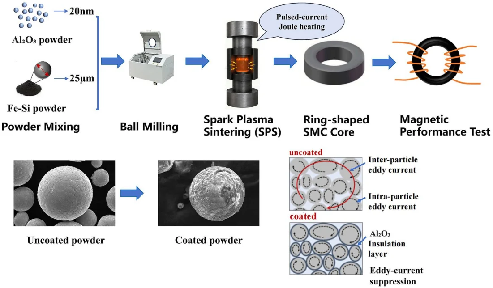

**Authors**　Fugui Liu, Yupeng Chen, Changgeng Zhang, Zhiwei Lin, Yongjian Li, Kai Liu  
**Journal**　Journal of Electronic Materials 55, 8866–8879 (2026)  
**First published online**　5 August 2026  
**DOI**　`10.1007/s11664-026-13088-2`

<a href="/assets/papers/2026/alumina-insulation-in-fe-si-powder-cores.pdf" download="alumina-insulation-in-fe-si-powder-cores.pdf">Download full paper (PDF)</a> · 14 pages · 7.9 MB

## Research brief

Alumina insulates Fe–Si particles against eddy currents, while the amount added also affects how much permeability the core retains.

We prepared Fe–6.5 wt.% Si powder cores with different alumina contents by high-energy ball milling and spark plasma sintering. At 500 kHz and 20 mT, core loss fell from 5057.1 W/kg in the uncoated core to 253.6 W/kg with 7.5 wt.% alumina. Raising the content to 10 wt.% cut loss further but lowered permeability. The 7.5 wt.% composition offered the best balance of loss and permeability stability among the samples tested.

## Abstract

Fe-Si soft magnetic composites (SMCs) typically suffer from deteriorated permeability stability and increased eddy-current loss under high-frequency operating conditions, which limits their application in advanced power electronics. In this work, Fe−6.5 wt.% Si SMCs coated with Al₂O₃ insulating layers were fabricated by high-energy ball milling followed by spark plasma sintering (SPS). The influence of Al₂O₃ content on the microstructure, electrical resistivity, and magnetic properties was systematically investigated over a frequency range below 500 kHz. The results show that the introduction of Al₂O₃ effectively enhances the electrical insulation between Fe-Si particles, leading to increased resistivity and reduced high-frequency core loss. Scanning electron microscopy (SEM) and energy-dispersive x-ray spectroscopy (EDS) line-scan results indicate that, as the Al₂O₃ content increases from 2.5 wt.% to 7.5 wt.%, the coating layer on the surface of Fe-Si particles evolves from incomplete coverage to a more continuous Al₂O₃ insulating coverage. This structural evolution is accompanied by improved permeability stability and a substantial reduction in magnetic loss. Among the investigated samples, the SMC containing 7.5 wt.% Al₂O₃ achieves the most favorable balance between permeability stability and core-loss reduction. The improved magnetic properties are mainly attributed to the enhanced interparticle insulation and the suppression of eddy-current effects provided by the Al₂O₃ coating. These results provide useful insights into the optimization of Fe-Si soft magnetic composites for high-frequency applications.

**Keywords**　Soft magnetic composites, spark plasma sintering, eddy current loss suppression, magnetic loss analysis

<figure style="margin:1.5rem 0">
  
  <figcaption>Graphical abstract. Powder processing, spark plasma sintering and magnetic testing, together with particle morphologies at different alumina contents. <a href="/assets/papers/2026/alumina-insulation-in-fe-si-powder-cores.pdf#page=1">Figure in the full paper</a></figcaption>
</figure>

[Chinese edition](/zh/news/alumina-insulation-in-fe-si-powder-cores/)
