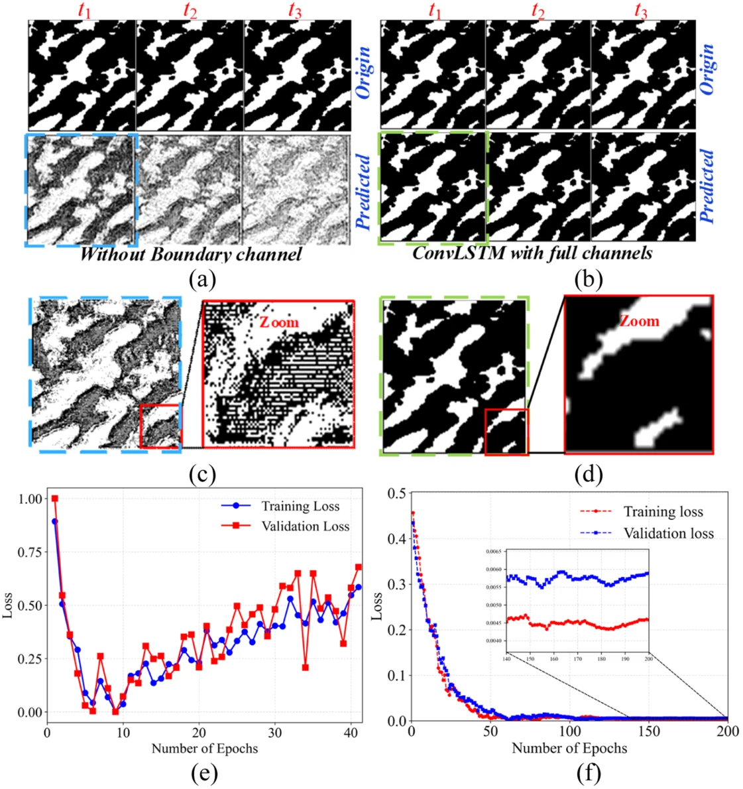

**作者**　Hao Zhang, Qingxin Yang, Yifan Chen, Yongjian Li, Changgeng Zhang  
**期刊**　Applied Soft Computing 203, 116305 (2026)  
**首次在线发表**　2026 年 8 月 25 日  
**DOI**　`10.1016/j.asoc.2026.116305`

<a href="/assets/papers/2026/predicting-domain-wall-motion.pdf" download="predicting-domain-wall-motion.pdf">下载论文全文（PDF）</a> · 12 页 · 16.0 MB

## 研究简介

克尔显微镜拍下的连续图像，能用来预测外加磁场变化时哪些磁畴会扩大、哪些会收缩。

我们用无取向硅钢的磁畴图像序列训练卷积长短期记忆网络（ConvLSTM），让模型同时利用畴壁轮廓、灰度纹理和前几帧的运动信息。在相同网络中加入灰度纹理特征后，各测试场强下的绝对预测误差平均降低 6.58%，最大降幅为 13.01%。

## 摘要

电机磁性材料的传统损耗模型主要依赖宏观磁参数和经验关系。在现代控制策略产生的瞬态激励下，这类模型对依赖微观组织的内在磁化过程描述不足，因而往往难以反映动态磁响应。磁畴的时空演化连接了微观磁化机理与宏观能量损耗，对理解材料内部的能量耗散过程尤为重要。为此，本研究提出一种基于卷积长短期记忆网络（ConvLSTM）的预测方法，将卷积特征提取与时间序列建模相结合，根据历史磁畴图像预测材料内部磁化状态的演化。结果表明，该方法能够预测复杂时空条件下的磁畴运动和磁化过程。引入磁畴边界和灰度纹理特征后，预测精度最高提升 13.01%。这一方法可用于分析磁性材料的微观组织，为优化材料磁性能和提升电机性能提供依据。

**关键词**　磁畴、机器学习、磁化过程、微观组织

<figure style="margin:1.5rem 0">
  
  <figcaption>图 7　完整模型与去除畴壁边界特征的模型对比，图中给出了实测与预测磁畴图像、局部放大图及训练和验证损失曲线。 <a href="/assets/papers/2026/predicting-domain-wall-motion.pdf#page=7">图片所在页</a></figcaption>
</figure>

[英文版](/2026/08/25/predicting-domain-wall-motion) · [返回团队新闻](/team-news/)
