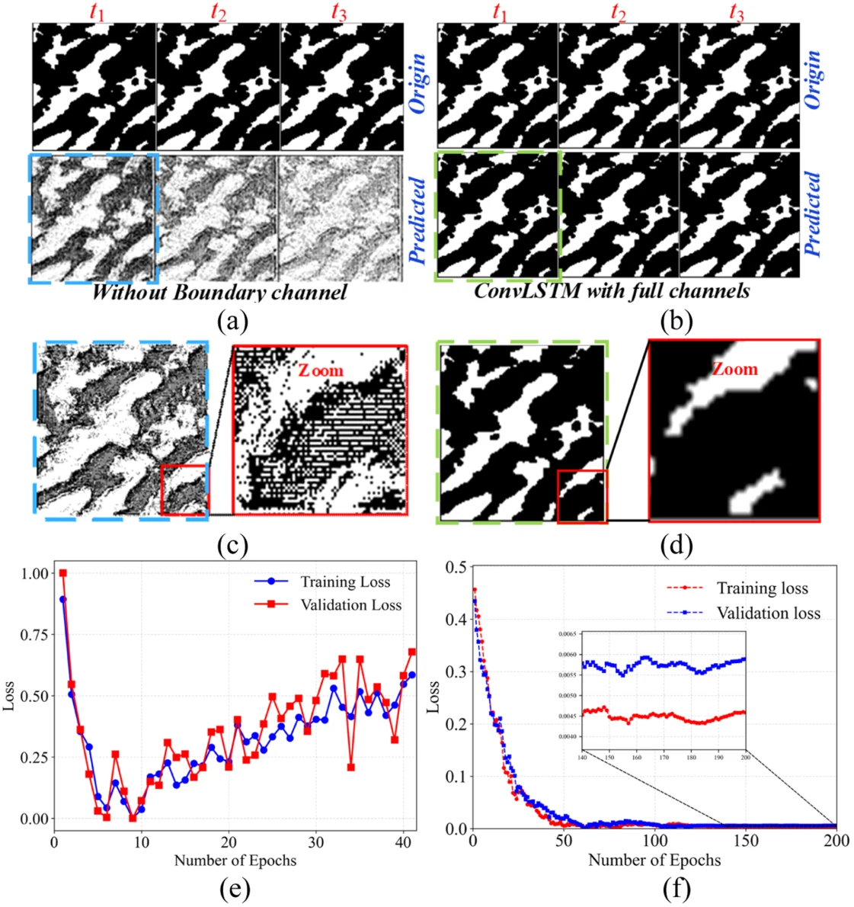

**Authors**　Hao Zhang, Qingxin Yang, Yifan Chen, Yongjian Li, Changgeng Zhang  
**Journal**　Applied Soft Computing 203, 116305 (2026)  
**First published online**　25 August 2026  
**DOI**　`10.1016/j.asoc.2026.116305`

<a href="/assets/papers/2026/predicting-domain-wall-motion.pdf" download="predicting-domain-wall-motion.pdf">Download full paper (PDF)</a> · 12 pages · 16.0 MB

## Research brief

A sequence of Kerr images helps predict which magnetic domains will grow or shrink as the applied field changes.

We trained a convolutional long short-term memory network (ConvLSTM) on successive images of non-oriented electrical steel. The model uses domain wall contours, grayscale texture and motion in preceding frames to predict the next domain pattern. Adding texture features to the same network reduced absolute prediction error by an average of 6.58% across the tested field strengths, with a maximum reduction of 13.01%.

## Abstract

Traditional modeling of energy loss in magnetic materials for electric machines primarily relies on empirical models based on macroscopic magnetic parameters. However, when subjected to transient excitations from modern control strategies, these models often fail to capture the dynamic magnetic response, since these models do not sufficiently represent the intrinsic, microstructure-dependent magnetization processes. The spatiotemporal evolution of magnetic domains serves as a crucial bridge linking microscopic magnetic mechanisms to macroscopic energy loss, playing a key role in understanding internal energy dissipation processes. In response to this challenge, this work presents a ConvLSTM-based predictive framework that combines convolutional feature extraction with temporal sequence modeling to predict the evolution of intrinsic magnetization states from historical magnetic domain patterns. The results show that the framework can predict magnetic domain motion patterns and magnetization processes under complex spatiotemporal conditions, and that incorporating magnetic domain boundary and grayscale texture features improves the prediction accuracy by up to 13.01%. This approach provides a robust tool for analyzing magnetic microstructures, offering valuable insights for optimizing magnetic material properties and enhancing the performance of electric motors.

**Keywords**　Magnetic Domain, Machine Learning, Magnetization process, Microstructure

<figure style="margin:1.5rem 0">
  
  <figcaption>Figure 7. Measured and predicted domain images, regional enlargements and learning curves for the full ConvLSTM and the model without the domain wall boundary channel. <a href="/assets/papers/2026/predicting-domain-wall-motion.pdf#page=7">Figure in the full paper</a></figcaption>
</figure>

[Chinese edition](/zh/news/predicting-domain-wall-motion/)
