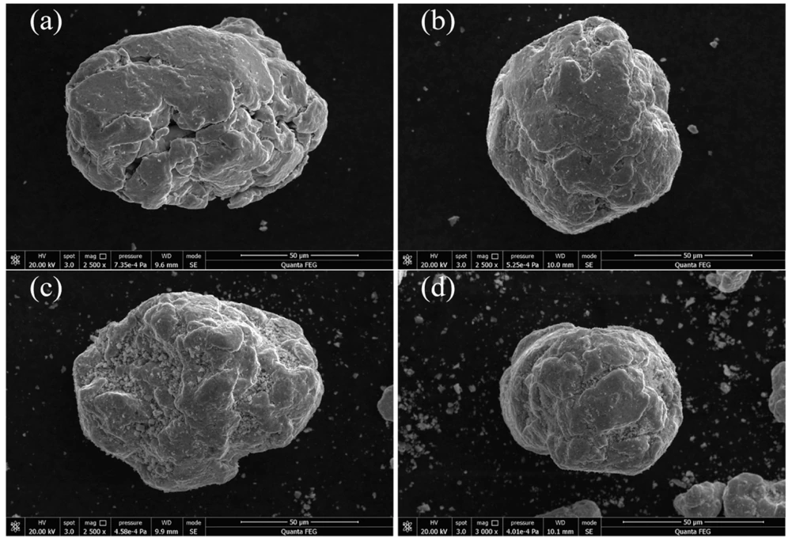
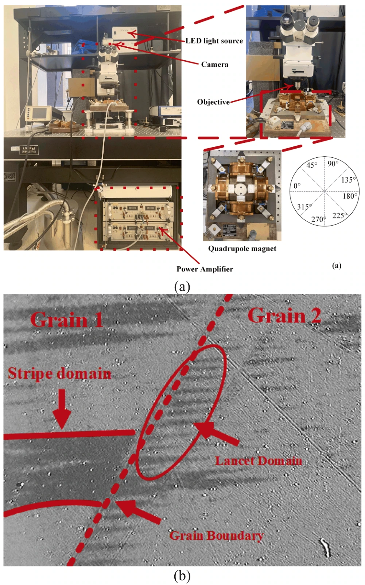

Ziran Guo, Guotao Sun, Kai Wang and Xiaoxiao Liu, all members of the class of 2026, successfully defended their master’s theses at the School of Electrical Engineering, Hebei University of Technology. Prof. Changgeng Zhang supervised all four students. Their experiments ranged in scale from the coating on a single powder particle to vibrations measured on a transformer.

## What powder surfaces and magnetic domains reveal

**Ziran Guo** coated iron powder with nickel–zinc ferrite and consolidated it into magnetic cores by low-pressure spark plasma sintering. He used scanning electron microscopy to examine the coatings and compared the conductivity, permeability and loss of cores with different ferrite contents. Of the four compositions in the team’s published study, **2.5 wt%** ferrite gave the best overall magnetic performance over **20–200 kHz**. His thesis also incorporated the demagnetising effect of the particles into a hysteresis model for the cores.

<figure style="max-width:38rem;margin:1.25rem auto">
  
  <figcaption>Composite powder surfaces at different nickel–zinc ferrite contents. Figure 3 from the paper co-authored by Ziran Guo. <a href="/2025/01/04/paper-guoziran">Paper and figure source</a></figcaption>
</figure>

**Guotao Sun** studied how magnetic domains in grain-oriented electrical steel change shape as an applied field rotates. He used a magneto-optical Kerr microscope to track the same region of the sheet, extracted features describing the domain shapes, and compared them with the magnetisation of the sheet as a whole. The images revealed how domain walls moved and supplied data for predicting the material’s response to a rotating field.

<figure style="max-width:25rem;margin:1.25rem auto">
  
  <figcaption>The magneto-optical Kerr microscope and the domains in the selected observation region. Figure 2 from the paper co-authored by Guotao Sun. <a href="/2025/08/05/rotational-magnetization-and-domain-shapes-in-grain-oriented-steel">Paper and figure source</a></figcaption>
</figure>

## Reading the condition of equipment from vibration

**Kai Wang** recorded vibrations on a dry-type transformer test rig to see whether the signals could identify which phase of the core had a loose upper-yoke bolt. Working with a limited number of fault samples, he compared sensor locations and tested methods for detecting core looseness and winding faults.

**Xiaoxiao Liu** studied electrical contact and structural vibration.
